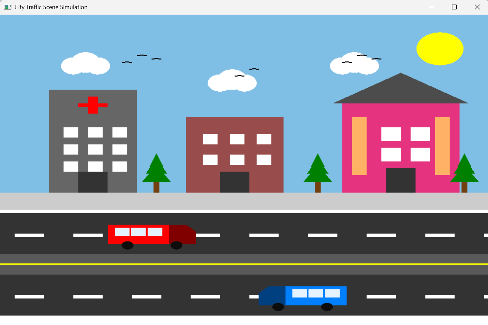

# City Traffic Scene Simulation

A 2D animated city traffic simulation built with **C++**, **OpenGL**, and **FreeGLUT** for **CSE412: Computer Graphics Lab** at Daffodil International University.

## 🖼️ Output Preview



## ✨ Key Features

- **Buses moving in opposite directions:** a red bus and a blue bus travel in opposite lanes and loop back when they leave the screen.
- **Flapping birds:** V-shaped birds drawn with `GL_LINES` that flap as they fly.
- **Drifting clouds:** clouds built from overlapping circles.
- **Growing sun:** the sun grows with an ease-out animation.
- **Detailed cityscape:** a hospital, a residential building, a pitched-roof building, pine trees, sidewalks, and dashed road dividers.
- **Smooth animation at ~60 FPS:** double buffering (`GLUT_DOUBLE`) with a `glutTimerFunc(16, update, 0)` update loop.

## 🧠 Algorithms & Concepts

| Concept | How it is used |
| --- | --- |
| Midpoint Circle Algorithm | Circles (sun, clouds, wheels) approximated with a 60-segment trigonometric polygon |
| Bresenham Line Concept | Line-based drawing such as bird wings and road markings |
| Scan-Line Polygon Fill | Filled shapes (buildings, buses, roads) drawn with `GL_POLYGON` |
| 2D Translation | Bus, bird, and cloud movement by updating object positions every frame |

## 🚀 How to Compile & Run

**Requirements:** Windows, a C++ compiler (MinGW `g++` or Code::Blocks), and FreeGLUT.

**Command line (g++):**

```bash
g++ src/main.cpp -o CityTraffic -lfreeglut -lopengl32 -lglu32
CityTraffic.exe
```

**Code::Blocks:** create a GLUT/console project, add `src/main.cpp`, link `freeglut`, `opengl32`, and `glu32`, then build and run.

## 📁 Project Structure

```text
City-Traffic-Scene-Simulation/
├── src/
│   └── main.cpp              # OpenGL / FreeGLUT source code
├── assets/
│   └── output.png            # Output screenshot
├── docs/
│   └── CTSS_Final_Report.pdf # Full project report
├── .gitignore
├── LICENSE
└── README.md
```

## 📄 Documentation

The full project report is available here: [docs/CTSS_Final_Report.pdf](docs/CTSS_Final_Report.pdf).

## 👥 Team Members

- Fahim Montasir
- Md. Ibna Labid
- Mahidul Hasan

## 📜 License

This project is licensed under the [MIT License](LICENSE).
